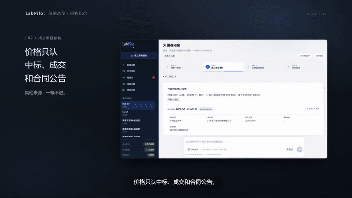
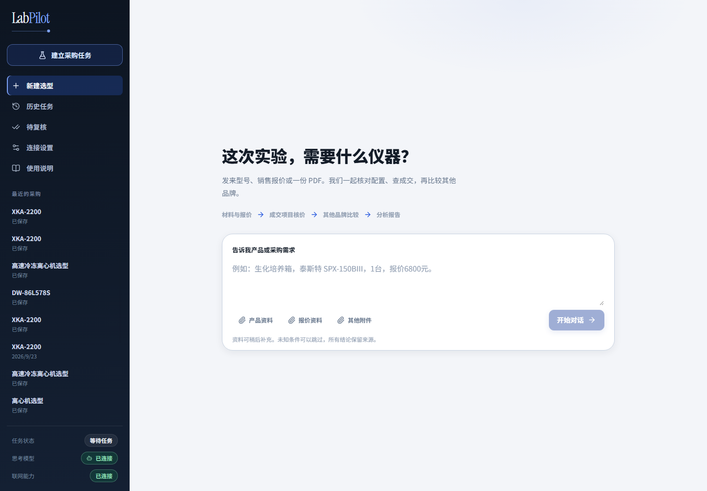
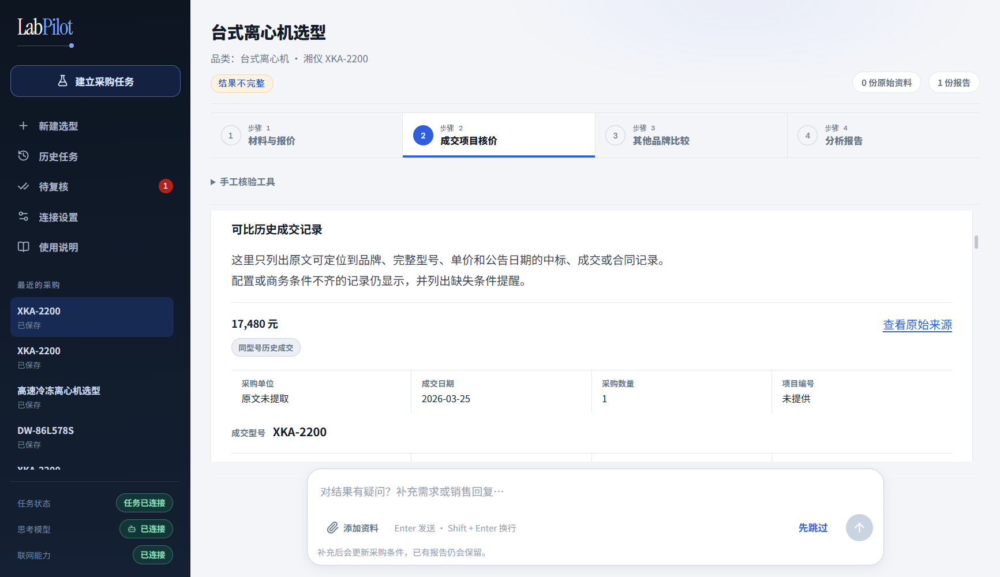
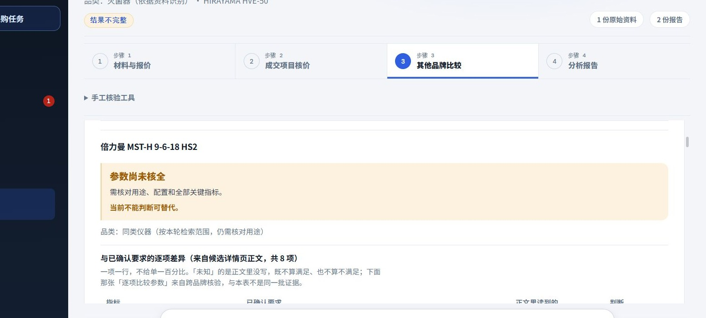
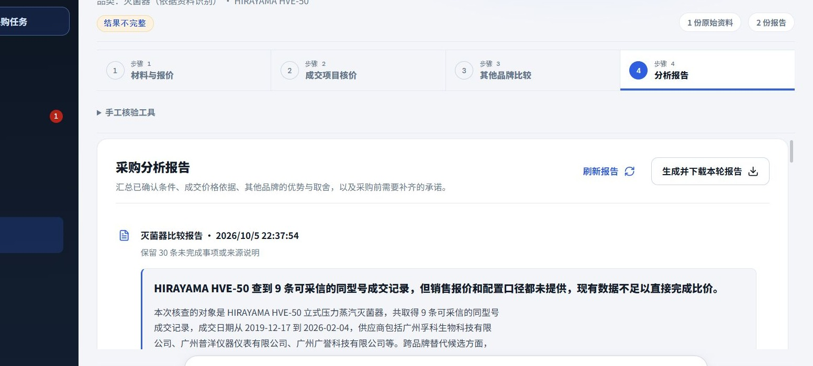
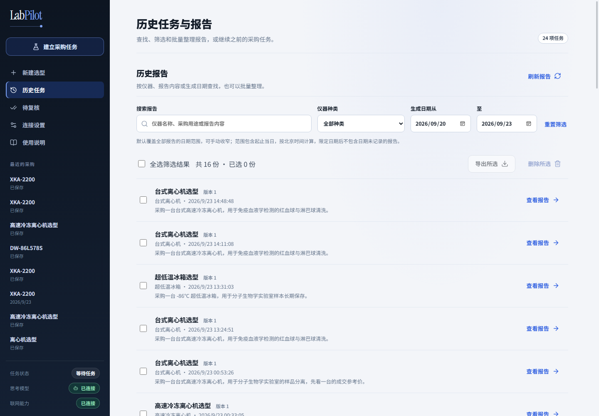

# LabPilot

**LabPilot 是一个本地部署的实验室仪器选型与采购比价工作台：每一条进入比较的价格，都能点回公开的原始单据。**

  



> **一个真实案例。** 华南农业大学买一台 Hirayama HVE-50 高压灭菌锅，销售口头报 65,000 元，说已经是底价。
> LabPilot 查到同型号最近一单成交 **62,000 元**（2026-02-04，订单号 `DD20260130000003`）——
> 点开是广东省教育部门"小零易购"的官方订单页，挂牌金额 90,000、协议价 62,000 两栏都在。
> 那个 65,000 在界面里不存在，它只作为口头报价，和成交价并排呈现。

▶ [演示视频（1 分 42 秒）](docs/media/demo.mp4) · [为什么不是直接问大模型](#为什么不是直接问大模型)

## 它解决什么问题

面向高校、科研院所、医院这类仪器采购密集的单位。要回答的是同一个问题：**这台仪器该不该买，这个报价值不值，有没有更合适的品牌。** 卡住的地方有三个：

- **报价只来自销售。** 电商价是挂牌价，官网只写"面议"，个人拿不到稳定的成交价做参考。
- **成交价藏在公告里，却搜不到。** 聚合站用 SEO 把转载页排在前面；官方公告标题通常只写"××单位设备采购项目"，仪器名和型号在正文或附件里。
- **公告里的价格要判读。** 同一条公告可能同时有中选价、落选投标价、预算价和废标标段，只做关键词抽取会把落选价当成成交价。

## 为什么不是直接问大模型

这个问题我们实测过：把同一个问题丢给一个联网的通用大模型，它查到 **63,000 元**，来源是 2024 年 5 月的一条中标公告转载；它自己也说明，查不到 2025–2026 年的价格。

差别不在"谁更聪明"，在于拿到的那个数能不能被核对：

| | 通用大模型 | LabPilot |
|---|---|---|
| 给出的数 | 63,000 元 | 62,000 元 |
| 这个数的来源 | 2024-05-11 中标公告转载 | 2026-02-04 成交订单 |
| 能不能点回原始单据 | 转载页，点不回官方订单 | 官方订单页，订单号、挂牌价、协议价三样都在 |
| 查不到时怎么办 | 仍给一个 2024 年的数，并注明查不到近两年 | 写明"不能判断"，参数没核全就不下结论 |

系统里所有进入比较的价格都带原文摘录、公告日期、原始链接和快照 sha256；点不开的、只出现在转载页的，不进正式比较。

## 四步流程

| 步骤 | 做什么 | 输出 |
|---|---|---|
| **01 材料与报价** | 上传说明书、报价单、参数表；解析页码、表格和 OCR | 本轮比较基准、资料状态、解析告警 |
| **02 成交项目核价** | 价格/替代品两条检索线；只收同型号成交；点回公告原文 | 原文摘录、公告日期、原始链接、页面快照 sha256 |
| **03 其他品牌比较** | 按已确认要求找候选；只列各自资料里的配置原文与出处 | 候选、差异、缺证、价格线索 |
| **04 分析报告** | 汇总判断、价格依据、替代取舍和待补承诺 | 可导出报告、历史版本 |

## 快速开始

需要 Python 3.11+ 和 Node.js。

```bash
python -m venv .venv
.venv/Scripts/pip install -e ".[parsing,test]"
.venv/Scripts/uvicorn backend.main:app --port 8000
```

```bash
cd frontend
npm install
npm run dev
```

打开 `http://127.0.0.1:5173`。前端默认请求 `http://127.0.0.1:8000/api/v1`，可用 `VITE_API_BASE` 覆盖。

**不配模型密钥也能启动界面**：落地页、新建任务、资料上传和连接设置都能打开；完整分析需要配置模型密钥，未配置时页面显示"配置有误"，不伪装成在线结果。

### 数据与解析组件

仓库自带一份只读的本地成交价库 `data/xlyg_prices.sqlite3`：11,697 单直购订单、12,675 行明细，来自公开的采购公示页面，clone 下来就能读。换路径用 `LAB_XLYG_DB`。库不在时价格接口返回 503，界面提示"本地价库未启用"，不会静默少一路数据。

`.[parsing]` 装的是一整套本机解析栈：PyMuPDF、pdfplumber、Docling、RapidOCR、onnxruntime。不装也能启动，但扫描件只能读到部分文字，报告里会写明"本机没有可用的本地识别组件，需恢复组件或提供可读原件"，不会把没读出来的算成解析成功。

## 关键设计

- **未知不等于满足。** 参数没核实，既不写满足，也不写不满足。
- **价格必须能回到原文。** 每条进入正式比较的价格都带原文、日期和链接；快照另存并记录 sha256。
- **拒收不等于删除。** 落选价、废标价、挂牌价不进正式比较，但保留拒收理由和原文。
- **跳过不等于丢数据。** 坏链接只影响那一条；用户看到人话，排查记录保留脱敏后的异常原文。
- **配置错误响亮失败。** 端点解析不了就点名配置项和当前值，不悄悄退回默认值。
- **共享词表。** 仪器品类、同义词和参数标题沉淀成一份词表，任务命名、候选发现和参数定位复用，不每个环节各造一套。

## 界面

| 新建任务 | 成交项目核价 |
|---|---|
|  |  |

| 其他品牌比较 | 分析报告 |
|---|---|
|  |  |

| 历史任务与报告 |
|---|
|  |

## 评测

37 例评测集：**固定集 5 + 内部验证集 22 + 盲测 10**，覆盖 15 个品类、1–160 页文档。31 例加权**候选抽取 F1 0.87**。

- 首批盲测 **85 项参数 100% 能回到原文**，疑似编造 **0 处**。
- 单份输入模型成本约 **0.004 元**；95 页手册 26 万字可压到 6148 字符，关键参数不丢。
- 盲测暴露过三类真实问题：把附件规格当成参数表、规格页没抓到、外文版式漏检。逐项改版式锚点和视觉兜底后，外文规格页样本的参数从 5/9 项补到 12/12 项。
- 固定集的两条真实失败也保留在案：PDF 候选提取为空、JPG OCR 缺口。空评测集返回 0，不谎报 100%。

评测用的 PDF 是第三方资料，不随仓库发布；仓库只保留评测集结构和失败分类。

## 技术栈

- **后端**：FastAPI、SQLite、DeepSeek API、Tavily/Exa 等检索通道
- **前端**：React、Vite、lucide-react
- **解析**：PyMuPDF、pdfplumber、Docling、OpenPyXL、OCR 适配层
- **测试**：pytest（后端）、Node test runner（前端）

当前规模：73 个 API 路径、18 张数据表。

```text
backend/     API、领域服务、检索与价格判据、存储
frontend/    React 工作台
scripts/     启动与测试脚本
tests/       后端测试与评测用例
docs/        截图与演示视频
```

## License

[MIT](LICENSE)
