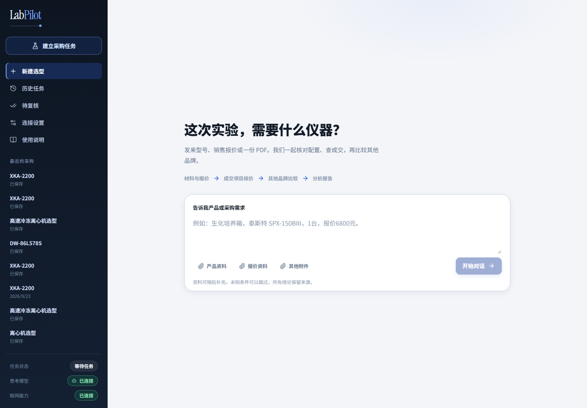
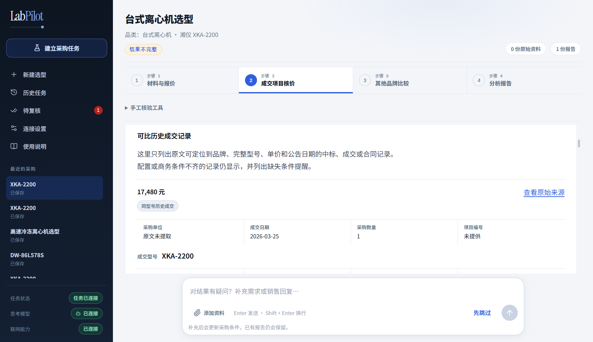
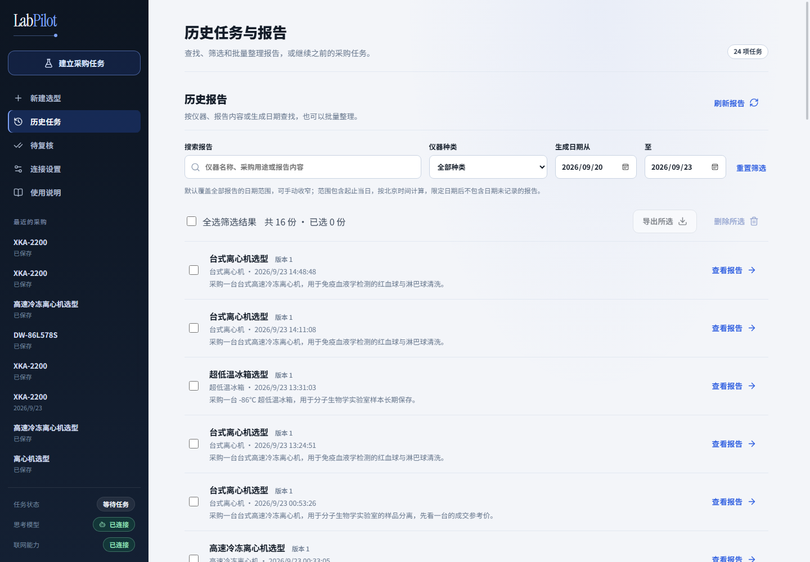

# LabPilot · 实验室仪器选型与采购比价工作台

面向兽医微生物实验室、兽药与药学分析实验室：把「这台仪器该不该买、销售报价值不值、有没有更合适的品牌」变成一条每一步都能回到原文的核对链路。


## 它解决什么问题

采购一台实验室仪器时，难点通常不是找不到价格，而是**判断哪条价格可以拿来比**：

- 销售报价和网上搜到的中标价，往往不是同一配置、同一口径，直接对比会得出错误结论；
- 网页上的「参考价」多是对外挂牌价或电商价，通常高于实际成交价；
- 中标公告里既有中选价格，也有落选投标价、废标项目，混在一起看就会算错；
- 采购方最终要向同事或上级解释「为什么选它」，而口头结论无法复核。

LabPilot 把这件事拆成四个步骤，每一步的输出都能点回原始来源：

**材料与报价** → **成交项目核价** → **其他品牌罗列** → **分析报告**



## 界面

- **新建选型**：用一段话（或直接粘贴销售报价）描述实验用途和已知条件，未知项可以留空。
- **材料与报价**：上传说明书、报价单、参数表，核对主机与配置，确认这一轮的比较基准。
- **成交项目核价**：查公开的中标、成交、合同记录，逐条核对品牌、完整型号、单价与公告日期。
- **其他品牌罗列**：按已确认的实验要求找候选型号，只罗列各自页面或资料里写到的配置原文与出处，不替用户判断是否满足。
- **分析报告**：汇总本次判断、价格依据、替代取舍和采购前需要补齐的承诺，可导出为 zip 归档。

价格证据长这样——金额、级别、公告日期、缺口，以及能点开的原始公告：



历史报告按任务版本留存，可筛选、批量导出：



## 怎么跑起来

需要 Python 3.11+ 和 Node.js。

后端：

```bash
python -m venv .venv
.venv/Scripts/pip install -e ".[parsing,test]"   # parsing 为 PDF/表格/图片解析所需
.venv/Scripts/uvicorn backend.main:app --port 8000
```

前端：

```bash
cd frontend
npm install
npm run dev
```

前端通过 `VITE_API_BASE` 指向后端 API 根路径（默认值指向本机 8000 端口的 `/api/v1`）。

后端按需读取的环境变量（**只列名称，密钥请通过环境变量提供，不要写进任何文件**）：

- `DEEPSEEK_API_KEY`、`DEEPSEEK_ENDPOINT`、`DEEPSEEK_MODEL`：思考模型的密钥、端点与型号；未配置时对话与分析功能不可用，页面会显示「未连接」。
- `TAVILY_API_KEY`：可选的独立联网搜索通道。
- `LAB_BROWSER_READING`：允许用浏览器渲染读取需要执行脚本才能出正文的页面。
- `LAB_IMPERSONATE_HTTP`：对启用 WAF 的站点启用 TLS 模拟传输（需额外安装 `impersonate` 可选依赖）。
- `LAB_USAGE_DATABASE`：模型调用账本位置；`LAB_MODEL_CALLS_PER_HOUR`：每小时模型调用上限。
- `LAB_CORS_ORIGINS`：允许访问 API 的前端来源。

连接设置页会把密钥写入**当前浏览器**的本地存储，并交给本机服务临时使用；密钥不写入项目文件，也不进入任务记录。

## 核心设计取舍

### 证据不足时，宁可说「不知道」

产品的默认答案不是「大概是这样」，而是明确说明缺什么：

- **未知不等于满足。** 某一项参数没有核实到，既不写成满足、也不写成不满足：候选卡片只罗列它自己页面上读到的配置原文与出处，判断留给采购员按原文核对。
- **系统不替用户判断候选是否满足要求。** 候选名单按后端核验结果收窄，卡片上出现的是事实（型号、配置原文、来源、价格依据）与证据质量问题（原文冲突、来源未核实），不是「满足／不满足」的结论。
- **不用历史成交推算当前市场价。** 页面不会给出「建议区间」或估算现值，因为历史成交的配置、年份和商务条件往往不同。
- **没有同型号成交价时，就直说判断不了。** 此时只会把网页上实际写着的金额单独列成「市场参考价」，并标注它为什么不能当成交价用。

### 价格必须能回到原文

每条进入正式比较的价格记录都带原文摘录（例如「品牌：… 规格型号：… 数量：… 单价(元)：…」）、公告日期和原始链接，抓取到的页面另存快照并记录 sha256。这样任何一条金额都可以被独立复核，而不是只能相信系统给出的数字。

### 哪些价格会被拒收

- **品牌或型号对不上的一律不收。** 同品类的其他型号不能互相认定成交价；并列型号公告（一条公告里出现多个型号）也不会被当作同型号证据。
- **落选投标价、废标与撤销公告的价格不收。** 公告正文里带撤销措辞、或价格属于废标标段的，不进入正式成交价比较。
- **挂牌价、电商价、预算价不进正式成交价比较。** 它们只作为「市场参考价」展示，并注明来源是转发页面还是对外报价。
- **配置或商务条件缺失的记录仍会显示**，但会列出缺失项（配置、税费、运费、安装培训、保修、交付等），并明确「这是同型号历史成交记录，不是当前报价」。
- 被排除的金额不会消失，而是附上拒收理由与原文，便于人工判断系统是否漏掉了有效证据：属于本次采购目标那条链路的集中列在成交价模块的「为什么这些价格没有被采用」里，属于某个候选品自己那份核价记录的归到那张候选卡片里（记录自带的目标型号就是归位依据）。

### 对外的说法不许比内部事实更粗

内部知道的是「某一个检索通道这次没有返回结果」，对外就不能说成「这一次检索没有返回任何结果」。这条规矩落到代码里：空结果必须**点名是哪个通道**，「跑过的通道全都空」是另一句话，通道**报错**又必须说成失败而不是「没有结果」。同理，一条链接抓不到只影响那一条，不许放大成整条流程失败。不确定性和限制条件要在**受影响之前**说出来——能提前（额度还剩多少）就提前，只能事后（某条来源被跳过）就在结果里如实标注。

### 「跳过」和「丢数据」必须能分开

用户看到的说明是**人话**，不带异常类名；排查用的记录带异常类名、脱敏后的原文和出错位置。坏链接要留痕、失败要留原文——静默跳过等于把事实抹掉。同一件事只允许一个出口、一句话。

### 配置错了就响亮报错，不兜底

配置里写死的端点解析不了、参数超出允许范围，系统会**直接报错并点名是哪个配置项、当前值多少、允许范围是什么**，而不是悄悄退回默认值继续跑。给配置错误兜底，等于把「装错了」变成「静默少做一步」。前端也不会把它显示成「网络问题」，而是明确说「配置有误」。

## 已知限制

- **联网检索本身有波动。** 同一份资料两次跑，候选型号可能不同——因为每次抓到的网页本来就不一样。系统如实标注每个候选的来源与证据，而不是假装结果稳定。判断时请看证据是否扎实，而不是看「上一次跑出来的是哪几个」。
- **第三方检索通道可能个别失败。** 某个通道这次没结果或报错时，会在结果里点名说明，其他通道的结果照常使用。
- **模型调用有额度上限**（每小时调用次数、单轮检索与抓取次数）。撞上上限时会明确告知，已取得的结果仍然可以查看。
- **需要外部模型与检索服务的密钥**才能使用完整功能；未配置时对话与分析不可用，页面会显示「配置有误」。
- 复杂扫描件的参数抽取存在波动（同一份资料不同轮次抽出的参数条数可能不同），因此单轮结果里的「参数条数」不宜当作能力指标；判定要看是否覆盖了关键指标。

## 项目结构

```text
backend/     FastAPI 应用、领域模型、检索与价格判据、存储
frontend/    React + Vite 工作台界面
scripts/     运维与验收脚本
tests/       后端测试与评测用例
docs/        产品设计与技术取舍文档
data/        本地运行数据（不提交）
storage/     上传文件与解析产物（不提交）
```

主要文档：[产品蓝图](设计规范-产品蓝图.md)、[模块地图](设计规范-模块地图.md)、[技术架构](设计规范-技术架构.md)、[产品边界与风险](设计规范-产品边界与风险.md)。

## 测试

后端：

```bash
python -m pytest -q
```

前端（Node 内置测试运行器）：

```bash
cd frontend
npm test          # 等价于 node --test "tests/*.test.mjs"
```
